# Glovebox

[](https://github.com/mcosgriff/glovebox/actions/workflows/ci.yml)
[](https://github.com/mcosgriff/glovebox/releases/latest)
[](LICENSE)
[](#install)

Private, offline-first vehicle maintenance tracker for Android. Everything is stored on the phone,
encrypted. The only network calls send a VIN (or year/make/model) to NHTSA.

## What it does

- **Add a vehicle from its VIN.** Type it or scan the barcode on the door jamb; NHTSA's decoder fills in
  the year, make, model, engine and drivetrain, and you correct anything it got wrong. No VIN works too.
- **Start from the maker's schedule** where Glovebox ships one (the 2017–2024 4Runner and the 2010–2014
  GTI so far), or a typical starter list, labelled as such. Every interval can be edited.
- **Reminders by mileage, time or whichever comes first**, with a lead time, snooze and skip. "Last done"
  always comes from your own log, so editing or deleting a record rolls the reminder back.
- **Log service** with costs, notes and encrypted receipt photos, and see it in History.
- **Recalls** from NHTSA for the vehicle, with mark as done, archive (doesn't apply) and the maker's VIN
  lookup.
- Milestones by mileage, torque specs, what it takes (oil, tires, wipers, fluids), documents, odometer
  reading from the dash with the camera, encrypted backup, PDF and Markdown export, imports.

## See it work

Recorded on an emulator with the debug build. The VIN is made up (a valid 2019 4Runner pattern with
serial 000000); the recalls are NHTSA's real list for that year, make and model.

| Add a vehicle from its VIN | Resolve recalls | Log service |
|:-:|:-:|:-:|
| 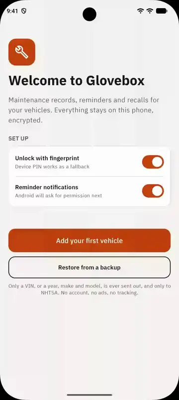 |  | 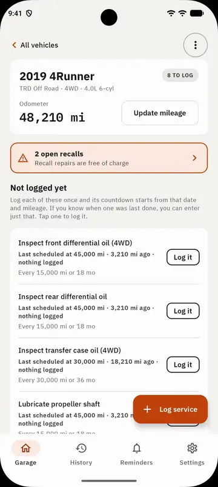 |

Adding a vehicle: decode the VIN, confirm the trim, track the maker's schedule. Recalls: mark one
done (it goes into the service history) and archive one that doesn't apply. Log service: one record
resets three reminders.

## Screenshots

| | | |
|:-:|:-:|:-:|
| 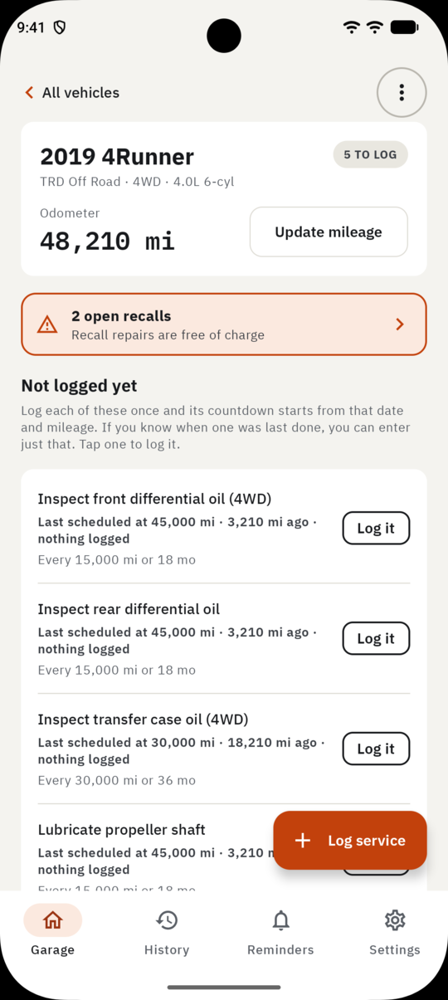 | 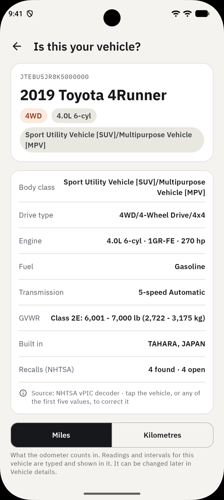 | 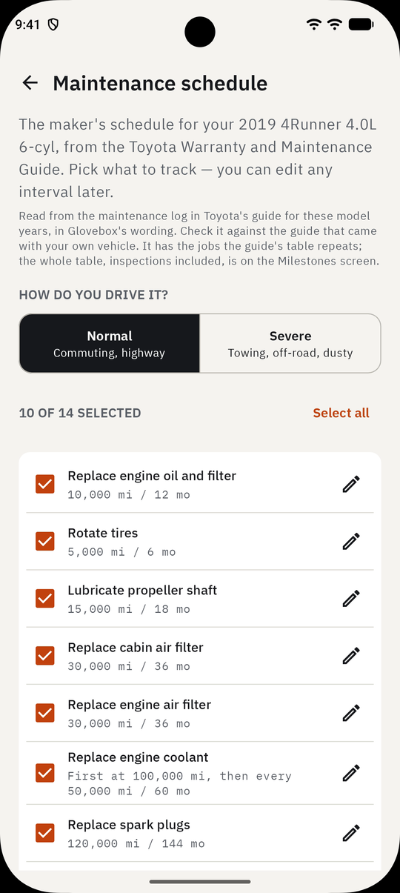 |
| Vehicle home | "Is this your vehicle?" | The maker's schedule |
| 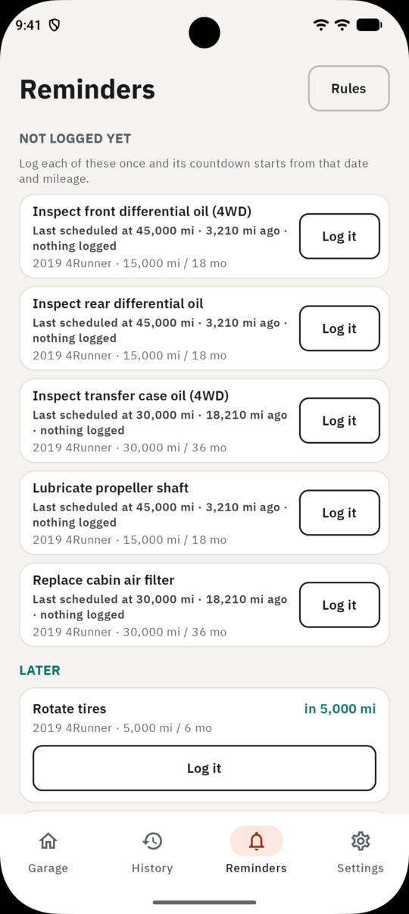 | 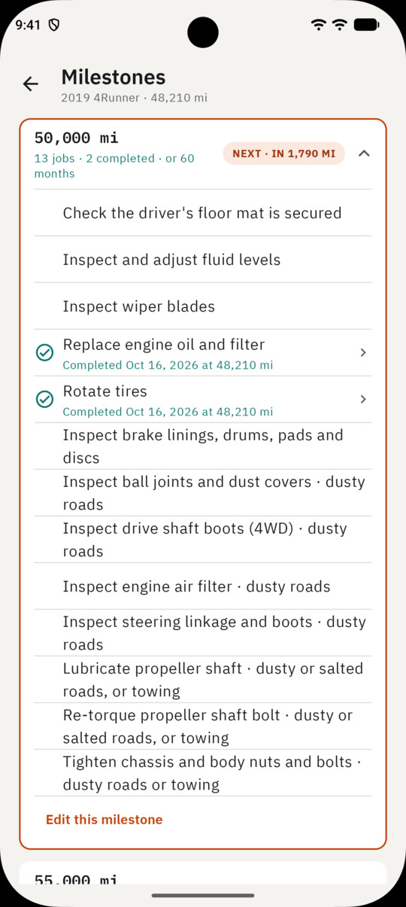 | 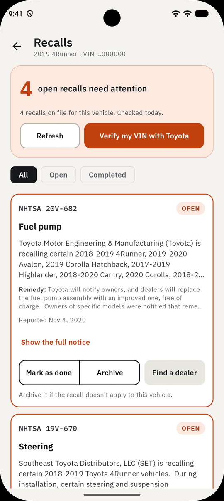 |
| Reminders | Milestones | Recalls |
| 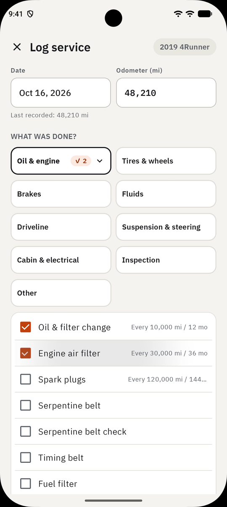 | 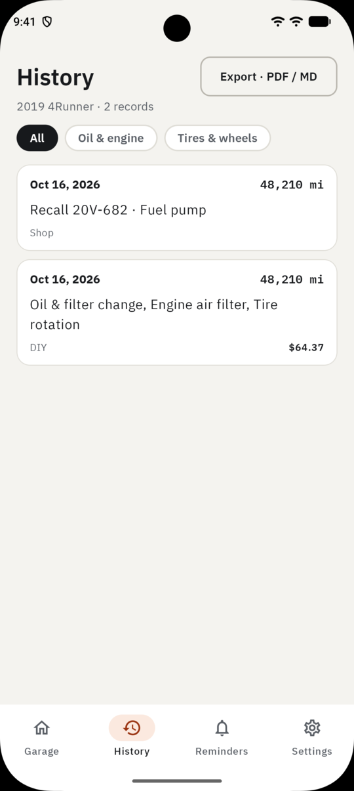 | 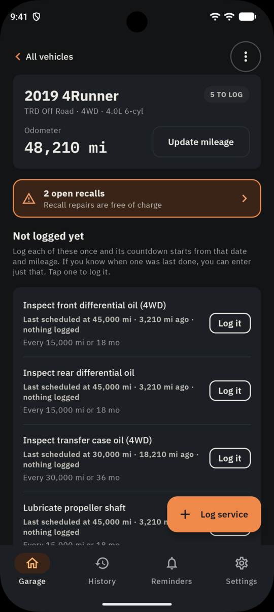 |
| Log service | History | Dark theme |

## Install

<a href="https://glovebox.cosgriff.io/obtainium/"></a>

Glovebox isn't on the Play Store. The badge opens a page whose button adds it to
[Obtainium](https://github.com/ImranR98/Obtainium) in one tap (GitHub doesn't allow the app link in a
README itself), and Obtainium then installs and updates it from GitHub Releases. Or add
`https://github.com/mcosgriff/glovebox` in Obtainium by hand, or download the APK from the
[latest release](https://github.com/mcosgriff/glovebox/releases/latest). Android 10 or later, 64-bit ARM.

## Verify your download

Every release APK is signed with the same key. Its SHA-256 certificate fingerprint is:

```
7D:61:01:C4:F2:27:19:FE:4F:80:17:83:BD:97:6B:5D:36:34:19:61:A5:AC:6A:BC:87:59:7A:DD:00:87:5E:F7
```

Check an APK before installing it with `apksigner verify --print-certs glovebox-vX.Y.Z.apk` (the
"SHA-256 digest" line, without colons), or check the installed app with
[AppVerifier](https://github.com/soupslurpr/AppVerifier). Android also refuses an update signed with a
different key. The same fingerprint is published for the app's package ID at
`https://glovebox.cosgriff.io/.well-known/assetlinks.json` (from `site/` in this repo), for
[Privacy Guides' verified apps](https://github.com/privacyguides/verified-apps).

To check that an APK was built by this repo's release workflow from its tag, use its build provenance:
`gh attestation verify glovebox-vX.Y.Z.apk --repo mcosgriff/glovebox`. Releases after v0.11.1 also
carry the signed provenance as `glovebox-vX.Y.Z.apk.intoto.jsonl`, which `gh attestation verify` takes
with `--bundle`.

## Security model

- Database: SQLCipher with a random 32-byte passphrase, wrapped by an AES-256-GCM key in Android Keystore
  (StrongBox when available). The key does **not** require a fingerprint, so background reminder and
  recall checks work while the phone is locked.
- Photos: Tink streaming AEAD, keyset wrapped by a separate Keystore key.
- Biometrics lock the **UI** (`AppLock`). "Hide in recent apps" sets `FLAG_SECURE`.
- Android auto-backup and device transfer are disabled; the app's own password-protected backup file
  is the only way to move data to a new phone.
- Delete all data destroys the Keystore keys first (crypto-erase), then deletes the files.
- No trackers: every pull request and every release is scanned with
  [Exodus Privacy](https://exodus-privacy.eu.org)'s tracker scanner
  ([`exodus-standalone`](https://github.com/Exodus-Privacy/exodus-standalone)), and a tracker, or a
  permission not in [`.github/privacy/permissions.txt`](.github/privacy/permissions.txt), stops the
  build. Each release's notes give the result and its report is attached (`glovebox-vX.Y.Z.exodus.json`).
  This is Glovebox's own scan with Exodus's tool, not Exodus vouching for the app, and it finds known
  tracker libraries, not behaviour.

  [](https://github.com/mcosgriff/glovebox/releases/latest)
  [](https://scorecard.dev/viewer/?uri=github.com/mcosgriff/glovebox)

## Building

### Modules

| Module | What lives there |
|---|---|
| `:domain` | Pure Kotlin: reminder engine (whichever first/last, mileage/time only), service-log rollback, torque units, VIN check digit. Unit-tested, no Android. |
| `:data` | Room + SQLCipher database, Keystore key management, Tink photo encryption, NHTSA client, settings (DataStore), data wipe. |
| `:app` | Jetpack Compose UI, Hilt, navigation, biometric app lock. |
| `:baselineprofile` | Generates the app's baseline profile and benchmarks its startup on an emulator. Ships nothing. |

### Opening the project

1. Open this folder in Android Studio and let Gradle sync (it installs the SDK if needed).
2. Run on a device or emulator with the `app` run configuration.
3. Run the fast tests anytime: `./gradlew :domain:test`
4. Upgrade the Android Gradle Plugin with Tools → AGP Upgrade Assistant.

## Releasing (maintainers)

1. Create a release keystore once and **back it up** — every update must be signed with the same key:
   ```
   keytool -genkeypair -v -keystore glovebox-release.jks -alias glovebox -keyalg RSA -keysize 4096 -validity 10000
   ```
2. Add the signing secrets to the `release` environment (Settings → Environments → release →
   Environment secrets), not as repository secrets:
   - `KEYSTORE_B64` — `base64 -i glovebox-release.jks | pbcopy`
   - `KEYSTORE_PASSWORD`, `KEY_ALIAS` (`glovebox`), `KEY_PASSWORD`
3. Release: merge the open **release PR** (title `chore(main): release X.Y.Z`). The
   `release-please` workflow keeps it up to date from the Conventional Commits on `main` — `fix:` bumps
   the patch version, `feat:` the minor, a breaking change (`feat!:` / `BREAKING CHANGE:`) the major —
   and it updates `CHANGELOG.md` and `version.txt`. Merging tags `vX.Y.Z`, creates the GitHub Release
   and starts the signed build; approve the waiting `release` run in the Actions tab. Release tags
   can't be moved or deleted afterwards. (Pushing a `v*` tag by hand still works.)

`applicationId` (`io.cosgriff.glovebox`) must never change after the first release.

The release APK is built for 64-bit ARM (`arm64-v8a`) only, which keeps it to about 22 MB. That covers
phones sold with Android 10 or later almost without exception; a 32-bit phone or an x86 emulator will
refuse to install it. Debug builds (`./gradlew :app:installDebug`) include every processor type.

## Roadmap

What's planned and in progress is tracked in [#33](https://github.com/mcosgriff/glovebox/issues/33).
The original design canvas, from before the app was built, is in [`design/`](design/README.md).

## How Glovebox is made

Glovebox is written with an AI coding assistant, and this says how, so nobody has to guess.

- **I decide what it does and how it works.** What the app should do, what it must never do (send
  anything but a VIN to NHTSA, guess at a service the owner didn't log, ship a torque value without a
  named source), and the architecture that keeps those promises are my calls. They are written down,
  with their reasons, in [`CLAUDE.md`](CLAUDE.md), including the ones I reversed after trying them.
- **Claude writes most of the code.** It works from those decisions, one ticket at a time. Every commit
  it had a hand in says so (`Co-Authored-By: Claude`), so the history shows which work is which.
- **Nothing reaches `main` without me.** Every change is a pull request that I review, try and merge
  myself; the assistant can open one but never merges.
- **It is tested, by machine and by hand.** The business rules live in a pure Kotlin module with unit
  tests, database migrations are tested against every past schema, and an end-to-end test drives the
  app on an emulator from first launch to restoring a backup. CI runs all of it on every pull request.
  Then I use the change on a real phone with a real vehicle, and send back what is wrong.
- **What it relies on is checked, not assumed.** A library has to make no network calls and carry no
  trackers: Google's ML Kit was turned down for its usage logging, and the barcode and text readers
  that replaced it were checked down to their native code. Maker's schedules and torque values come
  only from named documents, with what was read recorded in [`docs/`](docs/).

If you find something that looks careless, open an issue: it is mine to fix, whoever typed it.

## License

GPL-3.0. See [LICENSE](LICENSE).
